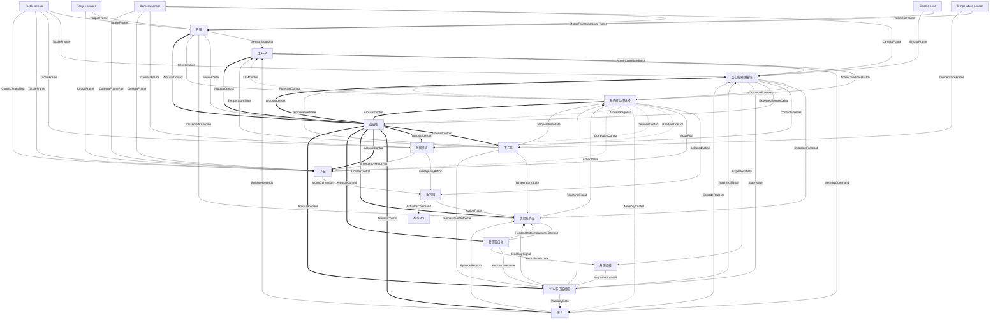

# photo-studio

海马体照相馆:




Edge label 对应的完整 boundary：
```
CameraFrame
{frame_id, pixel_array, capture_time}

TactileFrame
{frame_id, surface_element_id[], normal_force[], shear_force[], capture_time}

TemperatureFrame
{sample_id, probe_id, celsius, capture_time}

ENoseFrame
{sample_id, channel_id[], electrical_response[], capture_time}

TorqueFrame
{sample_id, joint_id[], measured_torque[], capture_time}

SensorSnapshot
{snapshot_id, packet_ids[], source_ids[], capture_times[], route_gains[]}

SensorDelta
{current_snapshot_id, previous_snapshot_id,
 pixel_change, contact_force_change, temperature_change,
 nose_response_change, torque_change}

ObservedOutcome
{event_id, source_packet_ids[], onset_time, duration}

TemperatureState
{temperature_sample_id, error_from_target, error_rate, time_to_limit}

TemperatureOutcome
{transition_id, error_before, error_after,
 relief = abs(error_before) - abs(error_after), action_id}

ActionCandidateBatch
{candidate_id[], kind[], payload[], deadline[]}

MemoryCommand
{operation: read | write,
 query_token_ids[], sensor_packet_ids[],
 episode_id, action_id, outcome_packet_ids[]}

EpisodeRecords
{episode_id, before_packet_ids[], action_id,
 after_packet_ids[], h_positive, h_aversive,
 start_time, end_time}

OutcomeForecast
{candidate_id, horizon,
 predicted_pixel_change, predicted_contact_force_change,
 predicted_temperature_change, predicted_nose_response_change,
 predicted_torque_change, probability, uncertainty}

ContactForecast
{candidate_id, time_to_contact,
 predicted_contact_force, probability}

ExpectedSensorDelta
{predicted changes for each sensor, uncertainty, expected_time}

StateValue
{transition_id, phase: current | successor, V, horizon}

ExpectedUtility
{event_id, due_time, expected_positive, expected_aversive}

ActionValue
{candidate_id, Q_positive, Q_aversive,
 expected_temperature_relief, expected_torque_cost, uncertainty}

OutcomeContext
{event_id, actual_sensor_packet_ids[],
 executed_action_id, temperature_state_id}

HedonicOutcome
{event_id, h_positive, h_aversive, latency, duration}

NegativeShortfall
{event_id, expected_utility, realized_utility,
 shortfall = max(0, expected_utility - realized_utility)}

SensorRoute
{sensor_channel_id, pass, gain, valid_until}

SelectedAction
{candidate_id, kind, payload, deadline}

MotorPlan
{action_id, joint_id[], target_trajectory, start_time}

EmergencyAction
{action_id, kind, payload, priority, deadline}

EmergencyMotorPlan
{action_id, joint_id[], target_trajectory, start_time}

CameraFramePair
{previous_frame_id, current_frame_id, time_difference}

ContactTransition
{previous_tactile_frame_id, current_tactile_frame_id}

MotorCorrection
{action_id, joint_id[], delta_torque[], apply_time, valid_until}

ActionTrace
{action_id, actuator_command_ids[], start_time, end_time, completion_status}

ActuatorCommand
{command_id, actuator_id, control_mode, setpoint, apply_time}

TeachingSignal
{transition_id, delta, causal_action_id, eligibility_until}

PlasticityGate
{transition_id, delta_sign, delta_magnitude, valid_until}

LLMControl
{run, max_reasoning_steps, max_output_tokens,
 control_token_ids[], valid_until}

ReadoutControl
{publish, publication_period, valid_until}

ForecastControl
{candidate_ids[], horizon, max_compute_steps, stop}

DefenseControl
{allowed_normal_action_ids[], inhibit_until}

MemoryControl
{allow_read, allow_write, max_records}

ArousalRequest
{requested_gain, duration}

CorrectionControl
{joint_ids[], correction_enabled, max_delta_torque}

ArousalControl
{target_id, activation_gain, plasticity_gain,
 reset_state, valid_until}
```

海马的核心 boundary：

> 输入“按时间对齐的实际经历”和“残缺的回忆线索”；输出“补全后的事件序列”。

| 来源 → 海马 | 输入 |
|---|---|
| 主 LLM／皮层接口 → 海马 | `EventState {event_id, sensor_packet_ids, cortical_token_ids, temperature_state_id, time}` |
| 执行层 → 海马 | `ActionTrace {event_id, action_id, actual_commands, start, end, status}` |
| 腹侧苍白球／下丘脑 → 海马 | `InternalOutcome {event_id, h_positive, h_aversive, temperature_relief}` |
| 主 LLM／杏仁核／伏隔核 → 海马 | `RecallCue {cue_id, known_event_fields, unknown_field_mask}` |
| VTA／蓝斑核 → 海马 | `PlasticityControl {event_id, write_gain, replay_priority, valid_until}` |

| 海马 → 目标 | 输出 |
|---|---|
| 海马 → 主 LLM／杏仁核／伏隔核 | `RecalledEpisode {cue_id, episode_id, match_score, ordered_events[]}` |
| 海马 → 主 LLM／杏仁核／伏隔核 | `ReplaySequence {episode_id, ordered_event_ids[], direction, compressed_timing}` |

其中：

```text
ordered_events[] =
[
  EventState_before,
  ActionTrace,
  InternalOutcome,
  EventState_after
]
```

`RecallCue` 是残缺的同类记录。例如只提供某个 sensor packet 和 action，海马补出此前一起出现的状态与结果。这对应 CA3 的 pattern completion。[Science 实验](https://pubmed.ncbi.nlm.nih.gov/27609885/)

生物结构上，处理后的皮层信息主要经内嗅皮层进入海马；CA1、下托再把重建结果送回内嗅皮层和皮层。[Nature Communications](https://www.nature.com/articles/ncomms6547) 海马也会重新发出压缩的经历序列，即 replay。[Nature 实验](https://www.nature.com/articles/nature04587)

当前图有一个实质问题：`主 LLM → 海马: MemoryCommand(write)` 允许 LLM 编造“实际发生过什么”。应改成：

- 主 LLM 只发送 `EventState` 和 `RecallCue`。
- 实际动作必须来自执行层。
- 实际爽／难受和温度变化必须来自对应模块。
- 海马用相同的 `event_id` 将它们绑定成 episode。


对。按这张图的定义，执行层是 leaf。`执行层 → 海马` 这条边是错的。

正确边界：

```text
基底核／动作选择器 → 海马
ChosenActionMarker {
  event_id,
  action_id,
  planned_start_time
}
```

它记录“系统决定尝试什么”。

```text
sensor → 丘脑／皮层接口 → 海马
EventStateAfter {
  event_id,
  sensor_packet_ids[],
  capture_time
}
```

它记录“实际发生了什么”。

因此海马保存：

```text
选择的动作
+ 动作前 sensor 状态
+ 动作后 sensor 状态
+ 内部结果
```

命令是否真的执行、执行效果如何，由 Camera、Tactile、Torque 等 sensor 证明。执行层只发送 `ActuatorCommand` 给 Actuator。

生物脑里的 self-motion 信息也主要经感觉反馈、内嗅皮层等路径进入海马，没有必要画一条直接的“执行器回传海马”连接。[内嗅皮层自运动编码实验](https://www.nature.com/articles/s41467-021-20936-8)、[内嗅皮层是海马主要输入](https://pubmed.ncbi.nlm.nih.gov/10516308/)

执行日志可以存在工程 telemetry 中，但不进入脑模型的因果图。


对，这个结构更干净：

```text
LLM 持续发送 EventPacket
Write Controller 决定存不存、存哪个抽象层
Hippo 按固定算法 recall
```

推荐让 LLM 同时生成多层 event：

```text
EventPacket {
  event_id,
  exact_view,       // 原始 token span + sensor packet 引用
  transition_view,  // state_before + action + state_after
  abstract_view,    // LLM 生成的事件摘要
  time
}
```

Controller 只负责选择：

```text
WriteDecision {
  event_id,
  store_exact,
  store_transition,
  store_abstract,
  merge_with_previous,
  retention_weight
}
```

这样 Controller 不需要理解和重新生成内容。它只决定：

- 写不写；
- 保存哪些 view；
- 是否与前一个 event 合并；
- 记忆保留强度。

Recall 固定为：

```text
RecallCue
→ 相似事件搜索
→ pattern completion
→ 返回匹配事件及时间相邻事件
```

```text
RecallResult {
  matched_event_ids[],
  stored_views[],
  previous_event_ids[],
  next_event_ids[]
}
```

三个方案：

- LLM 只发一种表示，Controller 现场压缩：Controller 太复杂。
- LLM 预先生成多层表示，Controller 选择：我推荐。
- Hippo 自己学习压缩：生物感更强，但 boundary 很难控制。

关键选择：同一个 event 允许同时保存多个 view，还是只能保存一个？我推荐同时保存多个。


对。完整路径应当是：

```text
Actuator 改变身体状态
→ Camera / Tactile / Torque 等 sensor 采样
→ 主 LLM 把 sensor 信息组织成 EventPacket
→ Hippo
```

所以海马的内容输入只有：

```text
主 LLM → Hippo: EventPacket
Write Controller → Hippo: WriteDecision
```

执行层保持 leaf：

```text
执行层 → Actuator
```

`EventPacket` 中的实际 self-motion 数据引用 `TorqueFrame`、`TactileFrame`、`CameraFrame`。不需要 `执行层 → Hippo`，也不需要 `基底核 → Hippo` 的事件内容连接。


对。我的问题错了。我把“学习信息瓶颈”降成了数据库格式选择。

存多个 view 会绕过你的核心目标：系统无需决定什么值得保留、需要压缩到什么程度。

正确结构：

```text
LLM → Hippo
Event {
  event_id,
  full_event_tokens,
  time
}

Write Controller → Hippo
EncodeControl {
  write_gate,          // 写不写
  memory_token_budget, // 能保存多少信息；越少越抽象
  merge_window,        // 合并多长时间内的 events
  retention_strength  // 保留强度
}
```

海马只生成一条 trace：

```text
memory_trace =
    HippoEncoder(events_in_merge_window, EncodeControl)
```

Recall 保持固定：

```text
RecallCue
→ 固定匹配与 pattern completion
→ memory_trace + 时间邻居
```

所以真正要学习的 boundary 就是：

```text
Event
EncodeControl
MemoryTrace
```

其中 `memory_token_budget` 和 `merge_window` 形成必须做取舍的 representation bottleneck。


对。当前完整图确实缺少这个节点。我定义了 `EncodeControl`，却没有定义谁生成它。

应新增：

```text
Memory Write Controller
（生物映射：内侧隔区／基底前脑式模块）
```

连接：

```text
主 LLM → Controller
EventPacket

蓝斑核 → Controller
SurpriseSignal {
  event_id,
  prediction_error_magnitude
}

VTA → Controller
TeachingSignal {
  event_id,
  delta
}

Hippo → Controller
MemoryPressure {
  free_memory_slots,
  recent_write_rate
}

Controller → Hippo
EncodeControl {
  event_id,
  write_gate,
  memory_token_budget,
  merge_window,
  retention_strength
}

主 LLM → Hippo
EventPacket
```

Controller 看见 event，但不能修改 event 内容。它只产生写入控制。

生物证据支持内侧隔区调节海马的 encoding/retrieval 状态，以及乙酰胆碱增强新输入的编码。[JNeurosci 实验](https://pubmed.ncbi.nlm.nih.gov/18287501/)、[Nature Communications 实验](https://www.nature.com/articles/s41467-021-25280-5)

`memory_token_budget` 和 `merge_window` 属于工程扩展。生物证据支持写入状态控制，没有直接对应“token 数量”的结构。


对。你的结构可以压成一个**可变容量记忆器**：

```text
LLM ── Event_t ───────────────▶ Hippo
LLM ── Event_t ───────────────▶ Write-control block
Hippo ── 最近记忆的匹配程度 ───▶ Write-control block
Write-control block ── K_t ───▶ Hippo
Hippo ── 检索出的旧记录 ───────▶ LLM
```

`K_t` 是唯一的写入控制量：

- `K_t = 0`：不写。
- `K_t` 很小：只能保存少量 latent tokens，被迫高度抽象。
- `K_t` 较大：保存更多细节。

控制块只决定容量，不生成摘要。Hippo 学习怎样把 `Event_t` 压进这 `K_t` 个位置。

Recall 可以完全固定：

```text
当前 Event_t
→ 计算与所有 memory key 的相似度
→ 取 top-k
→ 连同固定数量的时间邻居返回 LLM
```

这样没有独立的 recall controller。每个新 `Event_t` 自动触发读取，然后控制块决定它是否值得写、值得占多少记忆容量。


对。我把一条控制边错误地画成了新节点。删掉。

沿用现有的基底核：

```text
LLM ── Event_t ───────────▶ Hippo
基底核 ── memory_slots K_t ─▶ Hippo
Hippo ── 检索出的旧记录 ───▶ LLM
```

- `K_t = 0`：不写
- `K_t` 小：高度压缩
- `K_t` 大：保留细节

Recall 仍由 Hippo 固定执行。没有 `Write-control block` 新节点。
